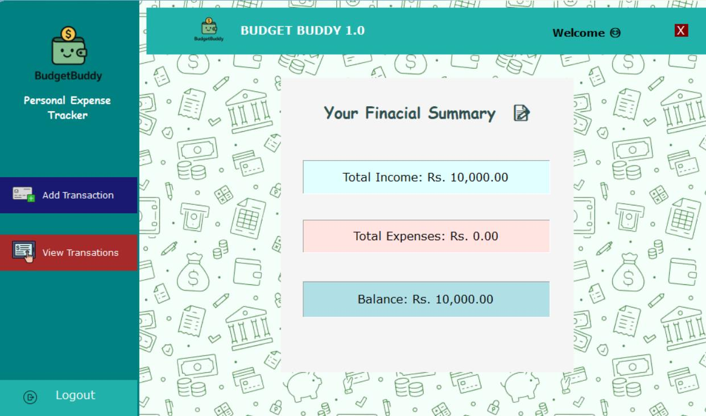
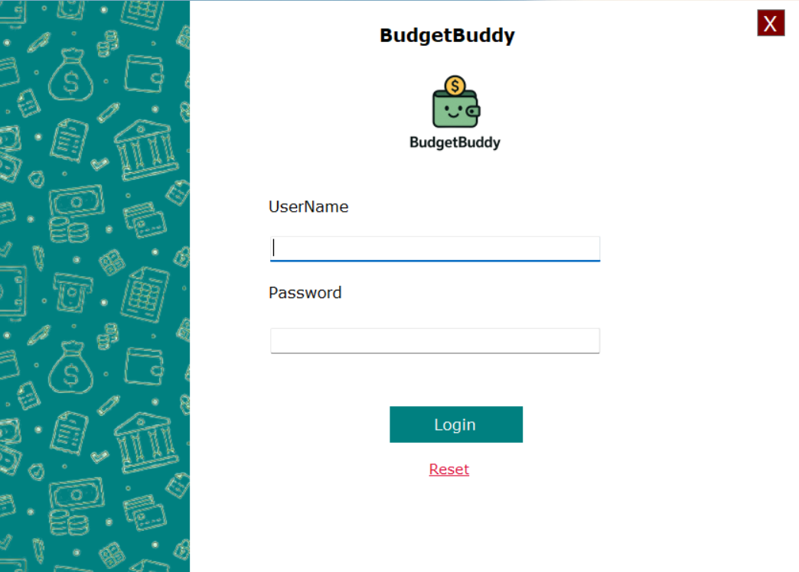
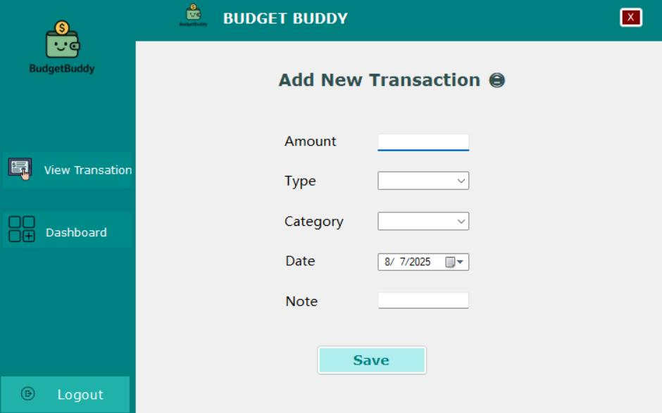
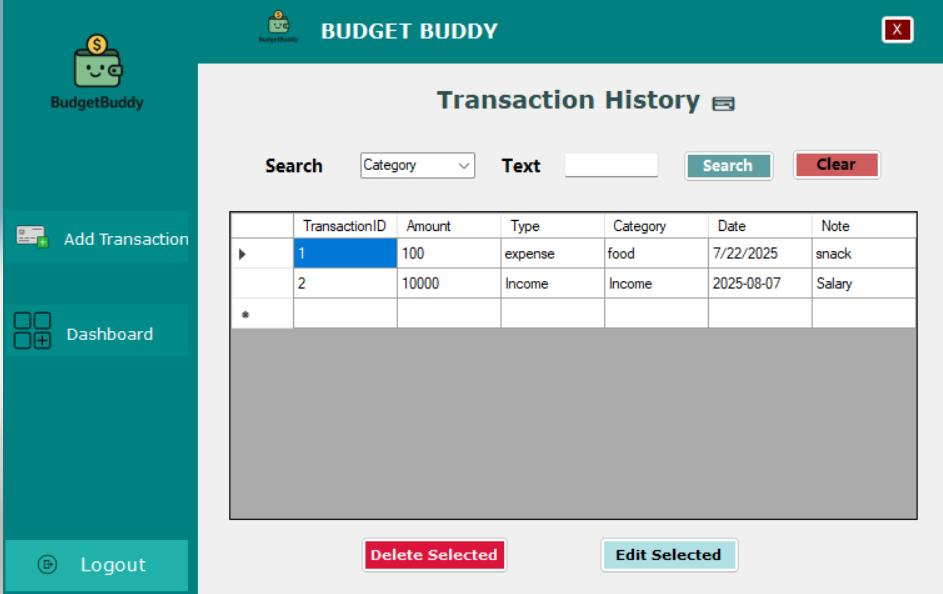
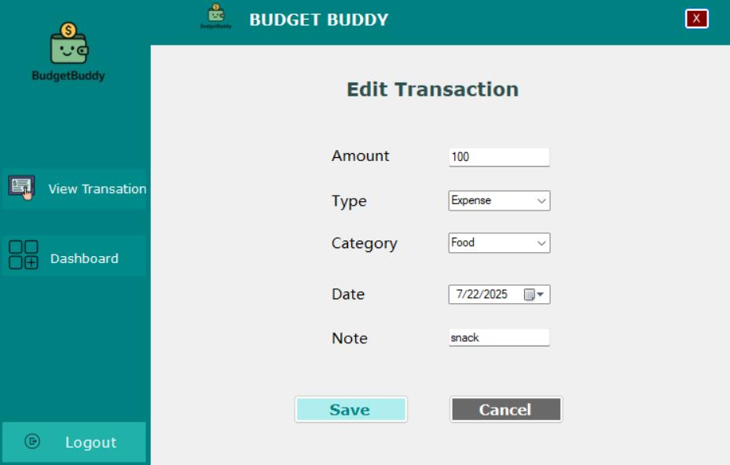
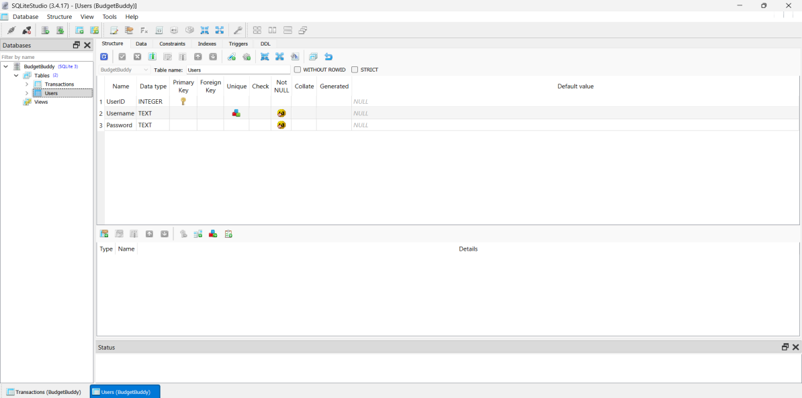
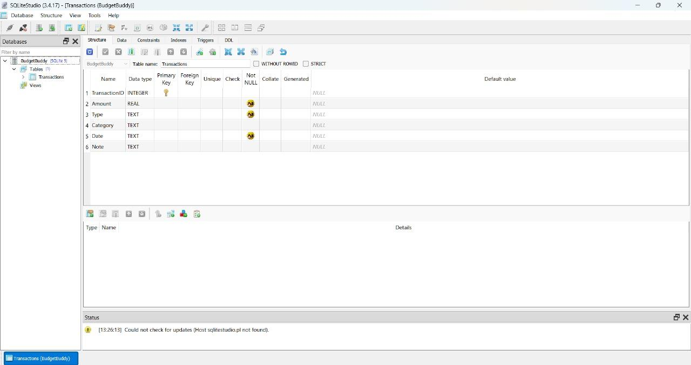

# BudgetBuddy 💰

**A desktop personal finance tracker that helps university students manage their income and expenses.**

Student life moves fast and budgets slip. BudgetBuddy gives students a simple place to record what comes in and what goes out, see their balance at a glance, and look back over their spending history.

Built with **C#**, **Windows Forms** and **SQLite**.


🎥 **[Watch the video demo on YouTube](https://youtu.be/NIcZ4aXeL9M)**

<p align="center">
  
</p>

---

## ✨ Features

- 🔐 **Login**: only signed-in users can see and manage their finance data
- 📊 **Dashboard**: live totals for **income**, **expenses** and **current balance**, plus recent transactions
- ➕ **Add transactions**: date, category, amount, type (income or expense) and an optional description
- ✏️ **Edit and delete** existing transactions
- 📋 **View all transactions** in a sortable table
- 🔍 **Search and filter** by date, category or amount
- ✅ **Input validation**: required fields and numeric amounts are checked before saving
- 🛡️ **Error handling**: invalid input, connection problems and query errors show clear messages instead of crashing

---

## 🖥️ Screenshots

<table>
  <tr>
    <td align="center"><br><b>Login</b></td>
    <td align="center"><br><b>Dashboard</b>: income, expenses and balance</td>
  </tr>
  <tr>
    <td align="center"><br><b>Add Transaction</b></td>
    <td align="center"><br><b>Transaction History</b>: search, edit, delete</td>
  </tr>
  <tr>
    <td align="center" colspan="2"><br><b>Edit Transaction</b></td>
  </tr>
</table>

---

## 🏗️ How it's built

### Layers
- **UI**: Windows Forms designed in Visual Studio, styled with **Guna.UI2**
- **Logic**: event handlers (`btnAdd_Click`, `btnDelete_Click`, ...) validate input, calculate totals and handle navigation between forms
- **Data**: **ADO.NET** with `System.Data.SQLite` and **parameterized** `INSERT`, `SELECT`, `UPDATE` and `DELETE` queries

### Database
A local SQLite file (`BudgetBuddy.db`) with two tables:

| Table | Columns |
|---|---|
| **Users** | `UserID` (PK), `Username` (unique), `Password` |
| **Transactions** | `TransactionID` (PK), `Amount`, `Type`, `Category`, `Date`, `Note` |

<details>
<summary>Schema in SQLiteStudio</summary>




</details>

### OOP concepts
- **Encapsulation**: transaction data is accessed through properties and methods with validation
- **Abstraction**: forms call into the logic layer instead of handling raw data directly
- **Inheritance and polymorphism**: income and expense transactions share common structure and behaviour

---

## 📂 Project structure

```
BudgetBuddy/
├── BudgetBuddy.sln
├── BudgetBuddy.csproj
├── Program.cs                     Entry point
├── Login.cs                       Login form
├── Dashboard.cs                   Summary dashboard
├── AddTransactionForm.cs          New transaction
├── EditTransactionForm.cs         Edit / delete
├── ViewTransactionsForm.cs        Transaction list + search
├── DatabaseHelper.cs              SQLite connection
├── BudgetBuddy.db                 SQLite database
├── App.config
├── packages.config                NuGet packages
└── screenshots/                   README images
```

---

## 🚀 Getting started

### Requirements
- Windows
- [Visual Studio](https://visualstudio.microsoft.com/) with the **.NET desktop development** workload
- .NET Framework **4.7.2**

### Run it
1. **Clone the repo**
   ```bash
   git clone https://github.com/MenadiDev/BudgetBuddy.git
   ```
2. **Open `BudgetBuddy.sln`** in Visual Studio.
3. **Restore NuGet packages**: right-click the solution → *Restore NuGet Packages* (`System.Data.SQLite`, `Guna.UI2.WinForms`, `EntityFramework`).
4. **Press F5** to build and run.

> The app connects to `budgetbuddy.db` in the folder it runs from (`bin/Debug`). Make sure the database file is there.

---

## 🧗 Challenges and lessons

**Challenges**
- Keeping the income, expense and balance totals updated instantly after every change
- Validating numeric input and empty fields to prevent crashes
- Debugging parameter mismatches and connection handling with ADO.NET
- Opening and closing forms cleanly so none stayed open in the background
- Merging UI, logic and database work from several people without conflicts

**Lessons**
- How a full desktop application fits together, from login to data storage
- Writing event-driven C# and parameterized ADO.NET queries
- Why validation and exception handling matter for a stable app
- Dividing work and resolving merge conflicts as a team

---

## 🛠️ Tech stack

| Area | Technology |
|---|---|
| Language | C# |
| UI | Windows Forms, Guna.UI2 |
| Framework | .NET Framework 4.7.2 |
| Database | SQLite (`System.Data.SQLite`) |
| Data access | ADO.NET |
| IDE | Visual Studio |

---

## 👥 Team (Group C)

| Member | Role |
|---|---|
| **Menadi P. D** | Team Leader, Logic Developer, UI Developer |
| Fernando C. G. K | Database Developer |
| Vithana K. V. K. R | Database Developer |
| Hiranya R. A. D. D | UI Developer |
| Abeywickrama M. N. D | UI Developer |
| Kolonnage K. A. S. M | Logic Developer |
| Sandeepani K. K | Testing and Reporting |
| Weerasinghe M. M. B. K | Testing and Reporting |

---

<sub>Built as a C# group project at NSBM Green University.</sub>
